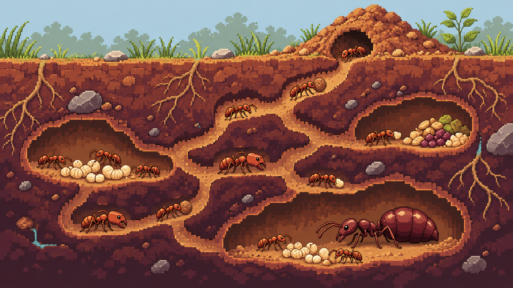

# Ant Farm Simulator

A native iPhone ant-colony simulation in an expandable, side-view pixel-art world.

**Current milestone: steps 1 and 2 — specification, native foundation, build delivery, and visual design.** The app currently displays an interactive design scene. Ants and colony values are reference fixtures, not a running simulation.

## Open and run

Open `AntFarm.xcodeproj` in Xcode 16 or later. Select the **AntFarm** scheme and an iPhone simulator, then Run. The app targets iOS 17+, iPhone, and landscape in both directions. There are no package dependencies.

For a physical iPhone, select your Apple development team in Signing & Capabilities and use an available bundle identifier. The default identifier is `com.owningturtle.antfarm`.

## What works in this milestone

- Native SpriteKit pixel scene with SwiftUI controls and an ant inspector.
- Pan, pinch, zoom buttons, recenter, selectable reference ants, and a sample trail overlay.
- Accessible sample-ant list, reduced-motion support, and a scope explanation.
- macOS GitHub Actions builds, fixture validation, XCTest checks, simulator launch and screenshot, and downloadable build artifacts.
- Optional manually requested ad hoc signing when the repository's Apple signing secrets are configured.

No excavation, population growth, learned behavior, save files, resource placement, or simulation clock is implemented yet. Those systems have a defined contract in the specification.

## Build downloads

Open [GitHub Actions](https://github.com/Owningturtle287/Ant-farm-simulation/actions), select a successful **iOS Foundation** run, then download an artifact:

| Artifact | Purpose |
| --- | --- |
| `AntFarm-simulator` | Simulator `.app`; does not install on an iPhone. |
| `AntFarm-unsigned-device` | Unsigned device `.ipa`; requires a compatible re-signing and installation process. |
| `AntFarm-design-preview` | Actual simulator screenshot and validation results. |
| `AntFarm-signed-adhoc` | Installable-on-provisioned-devices `.ipa`, only from a successful manually requested signed job. |

Downloading an IPA is separate from installing it. See [delivery setup](docs/DELIVERY.md) for the exact prerequisites and current verification status.

## Project guide

- [Simulation specification](docs/SPECIFICATION.md)
- [Technical architecture](docs/ARCHITECTURE.md)
- [Visual and interaction system](docs/design/DESIGN.md)
- [Delivery and signing](docs/DELIVERY.md)
- [Milestone acceptance and next steps](docs/MILESTONES.md)

The checked-in artwork is an art-direction concept used by the static native preview. It is not a device screenshot. GitHub Actions produces the actual simulator screenshot separately.
